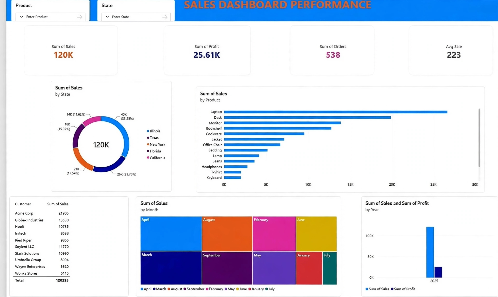

# SALES DASHBOARD PERFORMANCE

Power BI Sales Dashboard to track overall sales performance with Product and State filters.

## Dashboard Preview

## Key Metrics
- **Sum of Sales:** 120K
- **Sum of Profit:** 25.61K
- **Sum of Orders:** 538
- **Avg Sale:** 223

## What This Dashboard Shows

### 1. Filters
- **Product Filter:** Select any product to see its sales
- **State Filter:** Select any state to filter data

### 2. Sales by State
Donut chart showing sales share by state:
- Illinois - 40K (33.25%)
- Texas - 26K (21.76%)
- Florida - 21K (17.54%)
- New York - 18K (15.07%)
- California - 14K (11.62%)

### 3. Sales by Product
Top selling products:
- Laptop - Highest Sales (25K+)
- Desk, Monitor, Bookshelf, Cookware
- Lowest: Keyboard

### 4. Top Customers
- Acme Corp - 21905 (Top Customer)
- Globex Industries - 13530
- Soylent LLC - 11770
